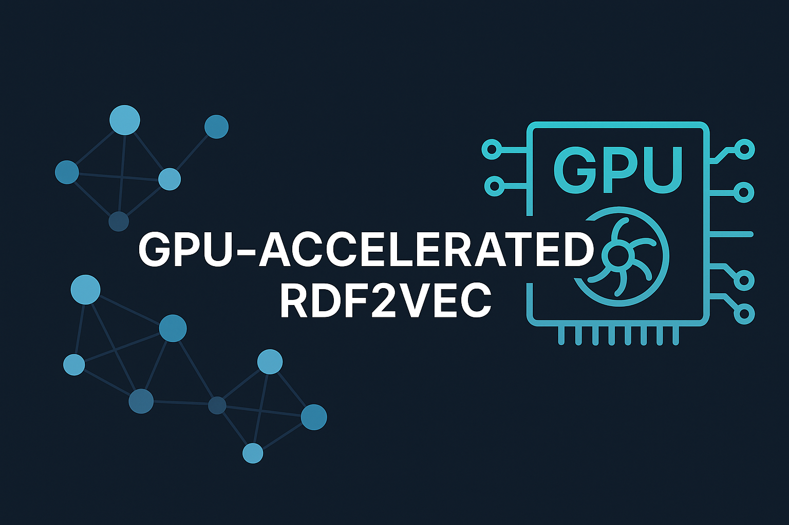

## gpuRDF2Vec

A scalable GPU based implementation of RDF2Vec embeddings for large and dense Knowledge Graphs.

[](https://opensource.org/licenses/MIT)



> [!IMPORTANT]
> This package is under active development in the beta phase. The overall class/ method design will most probably change and introduce breaking changes between releases

## Table of contents

The content of this repository readme can be found here:

- [gpuRDF2Vec](#gpurdf2vec)
- [Table of contents](#table-of-contents)
- [Package installation](#package-installation)
  - [Requirements](#requirements)
  - [Optional extras](#optional-extras)
- [gpuRDF2Vec overview](#gpurdf2vec-overview)
  - [Repository Structure](#repository-structure)
  - [Capability overview](#capability-overview)
- [Quick start](#quick-start)
- [Implementation Details](#implementation-details)
- [License](#license)
- [Roadmap](#roadmap)
- [Report issues and bugs](#report-issues-and-bugs)
- [Citation](#citation)

## Package installation

Install the package rdf2vecgpu by running the following command:

```
pip install rdf2vecgpu
```

This installs the package together with its GPU stack: PyTorch, PyTorch Lightning and the
RAPIDS libraries cuDF, Dask-cuDF and cuGraph 25.6 (CUDA 12 builds).

### Requirements

- Python 3.12 or newer
- Linux (on Windows, use WSL2; the RAPIDS pip wheels are Linux-only)
- An NVIDIA GPU with a CUDA 12.x driver

If you need a specific PyTorch build for your CUDA version, install it first with the
[PyTorch selector](https://pytorch.org/get-started/locally/), then install `rdf2vecgpu`. See the
[installation guide](https://rdf2vecgpu.readthedocs.io/en/latest/installation.html) for
multi-GPU setup and troubleshooting.

### Optional extras

```bash
pip install "rdf2vecgpu[gensim]"   # CPU Word2Vec trainer, RDF2VecConfig(backend="gensim")
pip install "rdf2vecgpu[mlflow]"   # MLflow experiment tracking
pip install "rdf2vecgpu[wandb]"    # Weights & Biases experiment tracking
pip install "rdf2vecgpu[test]"     # test suite
```

The pinned environments used for the ISWC 2025 benchmarks (gpuRDF2Vec and the baselines) are in
[`performance/env_files`](https://github.com/MartinBoeckling/rdf2vecgpu/blob/main/performance/env_files).

## gpuRDF2Vec overview

RDF2Vec is a powerful technique to generate vector embeddings of entities in RDF graphs via random walks and Word2Vec. This repository provides a GPU-optimized reimplementation, enabling:

- **Speedups** on dense graphs with millions of nodes
- **Scalability** to industrial-scale knowledge bases
- **Reproducible experiments** to test and qualify the overall implementation details

### Repository Structure

```text
.
├── src/rdf2vecgpu/         # the package
│   ├── gpu_rdf2vec.py      # GPU_RDF2Vec: load_data, fit, transform, save/load
│   ├── config.py           # RDF2VecConfig
│   ├── corpus/             # single- and multi-GPU walk generation (cuGraph)
│   ├── embedders/          # PyTorch Lightning Word2Vec, data loaders, gensim backend
│   ├── reader/             # KGFileReader: Parquet, CSV, ORC, N-Triples/N-Quads, rdflib
│   ├── helper/             # vocabulary construction
│   ├── logger/             # MLflow / W&B / no-op trackers
│   └── _compat.py          # cuGraph / dask compatibility patches
├── test/                   # unit and GPU end-to-end tests
├── docs/                   # Sphinx documentation (Read the Docs)
├── performance/            # ISWC 2025 benchmark scripts and environments
└── data_preparation/       # dataset conversion scripts
```

### Capability overview

- Random and BFS walk generation on the GPU with cuGraph, single- or multi-GPU, optionally weighted
- Skip-gram and CBOW training on the GPU with PyTorch Lightning (single- or multi-GPU DDP), or on the CPU with gensim
- Readers for Parquet, CSV, ORC, N-Triples/N-Quads and every RDF format rdflib parses
- Literal handling (drop or bin numeric literals) and MLflow / W&B experiment tracking
- The benchmark scripts of the ISWC 2025 paper are in the [performance folder](https://github.com/MartinBoeckling/rdf2vecgpu/blob/main/performance)

## Quick start

```python
from rdf2vecgpu import GPU_RDF2Vec, RDF2VecConfig

# Bundle all hyperparameters in a config object
config = RDF2VecConfig(
    walk_strategy="random",
    walk_depth=4,
    walk_number=100,
    embedding_model="skipgram",
    epochs=5,
    batch_size=None,
    vector_size=100,
    window_size=5,
    min_count=1,
    learning_rate=0.01,
    negative_samples=5,
    random_state=42,
    reproducible=False,
    multi_gpu=False,
    generate_artifact=False,
    cpu_count=20,
)

# Instantiate the pipeline
gpu_rdf2vec_model = GPU_RDF2Vec(config=config)

# Path to the triple dataset
path = "data/wikidata5m/wikidata5m_kg.parquet"

# Read the file, build the vocabulary and the graph
edge_data = gpu_rdf2vec_model.load_data(path)

# Fit the Word2Vec model and transform the dataset to an embedding
embeddings = gpu_rdf2vec_model.fit_transform(edge_df=edge_data)

# Write embedding to file format. Return format is a cuDF dataframe
embeddings.to_parquet("data/wikidata5m/wikidata5m_embeddings.parquet", index=False)
```

- Supported file formats:
  - `.csv` (with a header row)
  - `.parquet`
  - `.orc`
  - `.nt`, `.nq`
  - All supported [RDFlib file formats](https://rdflib.readthedocs.io/en/stable/plugin_parsers.html)
- Core `RDF2VecConfig` parameters (see the [configuration reference](https://rdf2vecgpu.readthedocs.io/en/latest/configuration.html) for defaults and details):
  - Walks: `walk_strategy` (`"random"`, `"bfs"`), `walk_depth`, `walk_number`, `walk_weighted` (biased random walks; requires a `weights` column)
  - Model: `embedding_model` (`"skipgram"`, `"cbow"`), `backend` (`"pytorch"`, `"gensim"`), `vector_size`, `window_size`, `min_count`, `negative_samples`, `learning_rate`
  - Training: `epochs`, `batch_size` (if `None`, a single-GPU run starts from 1/100 of the training pairs and, with `tune_batch_size=True`, Lightning's batch-size tuner scales it), `tune_batch_size`, `random_state`, `reproducible`, `cpu_count` (gensim worker threads)
  - Execution: `multi_gpu` (requires a Dask client), `num_nodes`, `generate_artifact`
  - Literals: `literal_predicates`, `literal_strategy`, `literal_n_bins`, `literal_bin_strategy`
  - Tracking: `tracker` (`"none"`, `"mlflow"`, `"wandb"`), `tracker_kwargs`, `tracker_run_name`

## Implementation Details

We achieve order-of-magnitude for large and dense graphs over CPU-bound RDF2Vec by engineering both the **walk extraction** and the **Word2Vec training** pipelines:

1. **GPU-Native Walk Extraction**  
   - All random-walk and BFS operations leverage cuDF/cuGraph kernels to avoid CPU–GPU data transfers and minimize latency.  
   - To generate *k* walks per node in one pass, we replicate node indices in a single cuDF DataFrame rather than looping—fully utilizing GPU parallelism and eliminating Python-loop overhead (∼15× speedup).  
   - BFS walks currently use GPU-side recursive joins; future work will reconstruct walks entirely in CUDA to remove join overhead.

2. **cuDF→PyTorch Lightning Handoff**  
   - Replaced Lightning’s default CPU-based DataLoader with a cuDF-backed pipeline: context/center columns live on GPU as DLPack tensors.  
   - Initial deep-copy loads incur extra VRAM, but thereafter all sampling/preprocessing occurs on-device, eliminating PCIe stalls.  
   - An “index-only” strategy (workers pull tensor indices instead of slices) uses CUDA’s pointer arithmetic for constant-time access, collapsing DataLoader overhead from ~85% of epoch time to near parity with model compute.

3. **Optimized Word2Vec Training**  
   - **Batch-Size Heuristic:** Estimate per-sample GPU footprint from cuDF loader, then set initial batch = (total VRAM) / (4 × footprint). This “divide-by-four” rule quickly homes in on a viable batch size, reducing tuning runs.  
   - **Kernel Fusion:** All sampling and tensor transforms migrated into PyTorch’s C++ back end, removing Python loops and the GIL, for consistent high throughput.  

4. **Scalable Data-Parallel Training**  
   - We use PyTorch Distributed + NCCL: each GPU holds the same graph shard but a unique walk corpus.  
   - Gradients are synchronized via `all_reduce` at regular intervals (~500 ms), amortizing PCIe/NVLink costs and ensuring linear scaling across nodes.

Contributor notes (the Dask `persist` / `broadcast=True` patterns and the cuGraph / dask
compatibility patches) are in [CONTRIBUTING.md](https://github.com/MartinBoeckling/rdf2vecgpu/blob/main/CONTRIBUTING.md).

## License

The overview of the used MIT license can be found [here](https://github.com/MartinBoeckling/rdf2vecgpu/blob/main/LICENSE)

## Roadmap

- [ ] Order aware Word2Vec following the details of [Ling, Wang, et al. "Two/too simple adaptations of word2vec for syntax problems.](https://aclanthology.org/N15-1142.pdf). [Issue item](https://github.com/MartinBoeckling/rdf2vecgpu/issues/2)
- [ ] Provide spilling to single GPU training to work around potential OOM issues faced during rdf2vec training [Issue Item](https://github.com/MartinBoeckling/rdf2vecgpu/issues/3)
- [X] Provide weighted walks for spatial datasets [Issue item](https://github.com/MartinBoeckling/rdf2vecgpu/issues/4)
- [X] Provide logging capabilities of complete Word2Vec pipeline for [Wandb](https://wandb.ai/site/) and [mlflow](https://mlflow.org/). [Issue item](https://github.com/MartinBoeckling/rdf2vecgpu/issues/5)
- [X] Optional gensim Word2Vec trainer backend (`backend="gensim"`)
  alongside the default PyTorch Lightning trainer. It trains on the CPU
  and streams the walk corpus from Parquet with constant memory, which
  suits machines with many CPU cores and few or small GPUs. Available since
  0.5.0 (the first PyPI release that contains it); opt in via
  `pip install "rdf2vecgpu[gensim]"` and `RDF2VecConfig(backend="gensim")`.

## Report issues and bugs

In case you have found a bug or unexpected behaviour, please reach out by opening an issue:

1. When opening an issue, please tag the issue with the label **Bug**. Please include the following information:
    - **Environment**: OS, Python/CUDA/PyTorch/RAPIDS versions (cuDF, cuGraph)
    - **Reproduction steps**: Exact commands or small code snippet
    - **Input data** graph format & size (attach a minimal sample if possible)
    - **Observed vs. expected behavior**
    - **Error messages/ stack traces** (copy-paste or attach logs)

2. We aim to respond to open issues within 3 business days
3. If you have identified a fix, fork the repo, branch off `main`, implement & test then open a PR referencing the issue. See [CONTRIBUTING.md](https://github.com/MartinBoeckling/rdf2vecgpu/blob/main/CONTRIBUTING.md) for the development setup, tests and docs build.

## Citation

If you use gpuRDF2Vec in your research, please cite the following paper:

```bibtex
@inproceedings{boeckling2025gpurdf2vec,
  author    = {B{\"o}ckling, Martin and Paulheim, Heiko},
  editor    = {Garijo, Daniel and Kirrane, Sabrina and Salatino, Angelo and Shimizu, Cogan and Acosta, Maribel and Nuzzolese, Andrea Giovanni and Ferrada, Sebasti{\'a}n and Soulard, Thibaut and Kozaki, Kouji and Takeda, Hideaki and Gentile, Anna Lisa},
  title     = {{gpuRDF2vec} -- Scalable {GPU}-Based {RDF2vec}},
  booktitle = {The Semantic Web -- {ISWC} 2025},
  series    = {Lecture Notes in Computer Science},
  year      = {2025},
  publisher = {Springer Nature Switzerland},
  address   = {Cham},
  pages     = {240--257},
  isbn      = {978-3-032-09530-5},
  doi       = {10.1007/978-3-032-09530-5_14}
}
```
