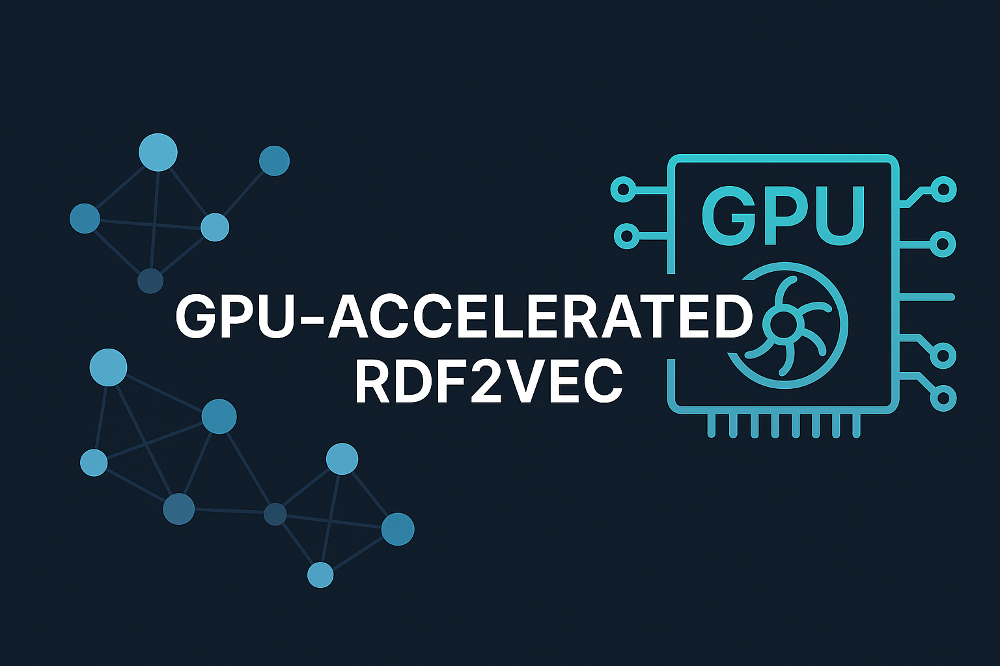

gpuRDF2vec documentation
========================

gpuRDF2Vec is a scalable GPU-based implementation of RDF2Vec embeddings for large and dense Knowledge Graphs.

.. note::
   Licensed under the `MIT License <https://opensource.org/licenses/MIT>`_.

How it works
------------

The data stays on the GPU from loading to training, except for RDF formats that are parsed with
rdflib; only the gensim backend trains on the CPU. The design and the benchmarks against CPU-based
RDF2Vec implementations are described in the
`ISWC 2025 paper <https://doi.org/10.1007/978-3-032-09530-5_14>`__.

1. **Loading** (``load_data``): the triples are read with cuDF (Dask-cuDF with ``multi_gpu=True``).
   Every IRI and literal becomes an integer token, and the encoded triples form a directed cuGraph
   ``MultiGraph``, so parallel edges with different predicates are kept.

2. **Walks** (``fit``): every start vertex (by default every subject) is repeated ``walk_number``
   times and the walks are generated in bulk by cuGraph, uniformly or, with ``walk_weighted=True``,
   biased by the edge weights. The predicate of every step is recovered from the edge that was
   actually traversed. BFS walks run one cuGraph BFS per start vertex, so their cost grows with the
   size of the graph. With ``multi_gpu=True``, the walks are generated on all GPUs of the Dask
   cluster.

3. **Training data** (``backend="pytorch"``): the walks are turned into (center, context) pairs with
   cuDF and handed to PyTorch through DLPack without leaving the GPU. The data loader indexes into
   these GPU tensors instead of copying batches.

4. **Training**: Skip-gram with negative sampling or CBOW, trained with PyTorch Lightning (Adam,
   16-bit mixed precision). On a single GPU, Lightning's batch-size tuner picks the batch size unless
   ``batch_size`` is set or ``tune_batch_size=False``. With ``multi_gpu=True``, the pairs are written
   to Parquet, the Dask cluster is released, and Lightning trains with DDP: each GPU reads its own
   block of the pairs and gradients are averaged every step. With ``backend="gensim"``, the walks are
   streamed from Parquet into gensim's Word2Vec on the CPU instead.

5. **Output** (``transform``): the embedding matrix is copied into a cuDF table with one row per
   token (``token``, ``word``, ``embedding_*``), optionally written to Parquet.

Report Issues and Bugs
----------------------

Please open an issue with the label **Bug** and provide using the following template under the `Github issue page <https://github.com/MartinBoeckling/rdf2vecgpu/issues>`__:

- **Environment**: OS, Python, CUDA, PyTorch, cuDF versions
- **Reproduction steps**: Code or CLI input
- **Dataset**: Format & size
- **Observed behavior** vs **expected behavior**
- **Error logs** or stack traces

We aim to respond within **3 business days**. For fixes, open a PR referencing the issue.

License
-------

This project is licensed under the MIT License.

.. toctree::
   :maxdepth: 2
   :hidden:
   :caption: Installation

   installation

.. toctree::
   :maxdepth: 2
   :hidden:
   :caption: gpuRDF2vec Usage

   gettingstarted
   configuration
   dataload
   training
   vectorretrieval
   tracking

.. toctree::
   :maxdepth: 2
   :hidden:
   :caption: API reference

   modules

Indices and tables
------------------

- :ref:`genindex`
- :ref:`modindex`
- :ref:`search`
